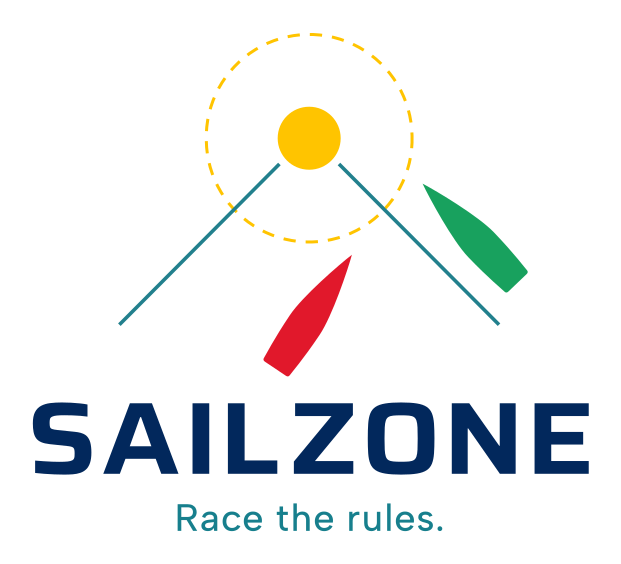

<a href="brand-kit/">brand-kit/</a>

<a href="https://sukuwc.github.io/fields/"><b>Play the test build</b></a>

# fields

## Roadmap

Last updated: 2026-11-11

### 1. Stabilize
- [x] Fix scenario 1 crash (out-of-bounds read in `get_field_velocity`): [#2](https://github.com/SukuWc/fields/pull/2)
- [x] AMR coupling corrections and one-cell domain shifts: [#3](https://github.com/SukuWc/fields/pull/3)
- [x] Circular disk refinement around the boat: [#4](https://github.com/SukuWc/fields/pull/4)
- [x] Constant-wind dev mode with the fluid sim off (`?devmode=1`): [#2](https://github.com/SukuWc/fields/pull/2)
- [x] WebGL canvas resizes with the window so the page no longer scrolls: [#17](https://github.com/SukuWc/fields/pull/17)
- [x] Guide and hull lines no longer vanish as the camera follows the boat: [#22](https://github.com/SukuWc/fields/pull/22)
- [x] Firefox keeps `?devmode=1` (and other URL settings) across reload: [#25](https://github.com/SukuWc/fields/pull/25)
- [ ] Robust fluid perf test: `performance.now()`, warm-up, median, opt-in ms limit, and a machine-independent cap of about 4500 ghost injections per step (the 12 ms "scenario 0 step stays cheap" check has failed since [#9](https://github.com/SukuWc/fields/pull/9))
- [ ] Faster coarse-to-fine ghost injection: decompose each coarse cell once, reuse scratch buffers, read populations by index (about 77% of the step after [#9](https://github.com/SukuWc/fields/pull/9), which took scenario 0 from about 4.5 ms to about 18 ms per step) (partial: [#32](https://github.com/SukuWc/fields/pull/32) caches coarse-cell decomposition once per inject pass; still open: reuse scratch buffers, read populations by index)
- [ ] Fluid steps fit the 16 ms frame budget again (about 36 ms per frame now at 2 steps per frame) (partial: [#86](https://github.com/SukuWc/fields/pull/86) brings one-boat ticks to about 10.6 ms on 2f and 6 ms on 4f at the new refinement default)
- [x] Simulation resolution setting (Default / x2 / x4 coarser) for cheaper fluid steps: [#36](https://github.com/SukuWc/fields/pull/36)
- [x] Experimental fast-wind grid modes (2 m cell every frame / 1.2×) and 150 m map: [#40](https://github.com/SukuWc/fields/pull/40)
- [x] Refinement budget: cell updates per root step (curl-threshold controller, `?cellBudget`, 4-boat scenario): [#43](https://github.com/SukuWc/fields/pull/43)
- [x] Configurable map size (50×100, 100×200, 200×400 m): [#44](https://github.com/SukuWc/fields/pull/44)
- [x] Arbitrary room sizes in the room TOML / `?map_size=WxH` (multiples of 4 m, 20–512 m per side, ≤ 160 000 m²): [#120](https://github.com/SukuWc/fields/pull/120)
- [x] Live room resize in remote mode: a TOML commit with new map dims rebuilds the server room at the new size; clients stay connected and rebuild their field texture, plane and camera: [#121](https://github.com/SukuWc/fields/pull/121)
- [x] Perf overlay: cells per level and field step time: [#26](https://github.com/SukuWc/fields/pull/26)
- [ ] CI: time the AMR "scenario 0 step stays cheap" check in the serial timing suite, not under the parallel unit run: [#147](https://github.com/SukuWc/fields/pull/147)
- [x] CI speed-up: scenario checks run in a parallel pool (`npm run check:all`, `CHECK_CONCURRENCY`), push runs only on main, docs-only changes skip Test: [#158](https://github.com/SukuWc/fields/pull/158)
- [x] Perf panel: per-level share of cell updates vs time, plus field / track / other ms per tick: [#72](https://github.com/SukuWc/fields/pull/72)
- [x] Fixed-step sim loop so simulation speed no longer depends on the display refresh rate (replaces the `planck-renderer` Runner; sim/client split, phase 1): [#46](https://github.com/SukuWc/fields/pull/46)
- [x] Sim modules without DOM: FieldPainter, simOptions, boat telemetry (sim/client split, phase 2): [#47](https://github.com/SukuWc/fields/pull/47)
- [x] Fixed 30 FPS: one sim pass per 30 Hz tick, render capped at 30 fps, per-pass boat terms converted, and a 4 m fast-wind default grid (`simRes=4f`): [#48](https://github.com/SukuWc/fields/pull/48)
- [x] Rules state per simulation (sim/client split, phase 3a): [#52](https://github.com/SukuWc/fields/pull/52)
- [x] Sim class: scenarios, race state, commands, snapshot (sim/client split, phase 3b): [#53](https://github.com/SukuWc/fields/pull/53)
- [x] SimHost interface + LocalHost (sim/client split, phase 4a): [#56](https://github.com/SukuWc/fields/pull/56)
- [x] Web Worker sim host by default (`?worker=0` for main thread) with transferred field buffers (sim/client split, phase 4b): [#57](https://github.com/SukuWc/fields/pull/57)
- [x] Node WebSocket sim server + RemoteHost: authoritative 30 Hz rooms, `--lockstep` mode, streamed wind field, `?host=remote` with LocalHost fallback (sim/client split, phase 5a): [#60](https://github.com/SukuWc/fields/pull/60)
- [x] Remote mode: fixed 30 Hz server frame clock, every frame broadcast to every client, frame-driven client with no rAF loop: [#62](https://github.com/SukuWc/fields/pull/62)
- [x] Server field streaming: per-level 1-byte grids coloured on the client, sent only to clients showing the field: [#64](https://github.com/SukuWc/fields/pull/64)
- [x] Compact JSON server frames: host sends scene state (statics only on change), client builds all geometry, about 1.8 KB per frame in scenario 0 instead of about 40 KB: [#66](https://github.com/SukuWc/fields/pull/66)
- [x] Client builds the readout/HUD panels and encounter overlays from compact JSON state (follow-up to #66, about 18% fewer bytes per frame in the four-boat scenario): [#70](https://github.com/SukuWc/fields/pull/70)
- [x] True- and apparent-wind chevrons sit upwind of the boat with tips pointing downwind (fixes a regression that pointed them upwind): [#59](https://github.com/SukuWc/fields/pull/59)
- [x] Run `npm test` in CI (test + server smoke workflow in `.github/workflows/test.yml`): [#63](https://github.com/SukuWc/fields/pull/63)
- [x] Parallel `npm test` via a `node --test` glob (no more `&&` chain in package.json), sim-res split into four files, wall-clock timing tests run serially (about 9 min to 2 min locally): [#143](https://github.com/SukuWc/fields/pull/143)
- [x] Default fluid grid `simRes=2f` (2 m root, 1 step per tick, about 15.6 ms field time per tick with one boat vs about 47 ms on 4f), wind clamped to each mode's stable ceiling (15 m/s on 2f), and the `2f34` mode removed: [#77](https://github.com/SukuWc/fields/pull/77)
- [x] Settings registry: one list of every setting (scope, type, default, validation, room command) read by the settings panel, URL sync and the server: [#79](https://github.com/SukuWc/fields/pull/79)
- [x] Rule data: sim sends rule codes and boat indices, every client writes the rule text and builds the overlay geometry (sim/client split; about 4.7% fewer bytes per frame in scenario 18): [#82](https://github.com/SukuWc/fields/pull/82)
- [x] Configurable boat refinement: max refinement level and boat refine radius (room setting, settings panel, URL), new default of 3 levels with a 3 m finest disk on every mode (about 10.6 ms per tick on 2f and 6 ms on 4f with one boat, vs about 20 and 38 ms with the full stack): [#86](https://github.com/SukuWc/fields/pull/86)
- [x] Headless scenario checks for scenarios 3–9 and 18 on a shared harness, plus `npm run check:all` to run every check (scenarios 7 and 9 marked as known sim discrepancies): [#84](https://github.com/SukuWc/fields/pull/84)
- [x] Gust kernels drop off-map samples instead of ring-searching for nearby water (fixes the periodic europe-1 slowdown to >1 s per tick): [#128](https://github.com/SukuWc/fields/pull/128)
- [x] Remote default preset matches live europe-1, including the custom race course (local solo stays on scenario 0): [#124](https://github.com/SukuWc/fields/pull/124)
- [x] In-game room settings locked behind admin login for remote games (server rejects room commands without `ADMIN_SECRET` auth; Login / Logout shared with the landing page): [#125](https://github.com/SukuWc/fields/pull/125)
- [x] One named import per line (sorted, trailing comma) in `src/` and `apps/` to cut import-line merge conflicts: [#144](https://github.com/SukuWc/fields/pull/144)

### 2. Wind and boat feel
- [x] Fluid sim on, stable from wind 5 through 25 with the sail wake on the fine grid: [#9](https://github.com/SukuWc/fields/pull/9)
- [ ] Per-boat wind shadow / dirty air (partial: [#9](https://github.com/SukuWc/fields/pull/9) gives each boat a sail wake, so a downwind boat reads slower true wind)
- [x] Depower toggle (X / touch): sails eased out and luffing with a 0.5 s ramp: [#51](https://github.com/SukuWc/fields/pull/51)
- [x] Near-matched viscosity on the default 4 m fast-wind grid (`simRes=4f`) so sail wakes match the 1 m and x4 grids: [#65](https://github.com/SukuWc/fields/pull/65)
- [x] Wind speed in true m/s everywhere (UI, sim, telemetry, scenarios) with perturbation propagation tests: [#67](https://github.com/SukuWc/fields/pull/67)
- [x] 45° and 22.5° wind propagation tests, root-grid wind read fixed by half a cell (no more 2 m wind jump at refinement edges on 4f), node-based vortex centroid: [#69](https://github.com/SukuWc/fields/pull/69)
- [x] Wind flow tracers replace the per-boat wind-arrow grid: particles carried by the local wind with fading tails, denser where wind is stronger, drawn over the colour field plot, live count/life/tail inputs (`?tracers`, `?tracerLife`, `?tracerTail`): [#68](https://github.com/SukuWc/fields/pull/68)
- [x] Wind-sweep check (3 to 15 m/s on 2f, 400 m map) and harness edge gap, so a boat pinned on the map edge is no longer mistaken for a high-wind stall: [#83](https://github.com/SukuWc/fields/pull/83)
- [x] Sail wake gain as a room setting (`?sailWakeGain`, default 16, range 0 to 64, live in local, worker and remote modes, no change at the default): [#87](https://github.com/SukuWc/fields/pull/87)
- [x] True-wind accuracy baseline: scenario 20 full-circle sweep plus `scripts/truewind-accuracy.mjs` measurement (2f baseline about 2.5° RMS direction error, 0.19 m/s RMS speed error; true-wind computation unchanged): [#88](https://github.com/SukuWc/fields/pull/88)
- [x] Boat true wind from a 1 m, 20-point ring vector mean instead of a single centre sample (used for boat smoothing, HUD and rules; scenario 20 RMS direction error about 2.47° to 2.33°): [#90](https://github.com/SukuWc/fields/pull/90)
- [x] True-wind own-sail-force correction on 2f: centre sample + (k0+ka·acc)·F_boat with piecewise gain→(k0,ka), |F| capped at 20 (scenario 20 dir RMS ~0.79/1.25/1.85° at gains 10/16/25; other modes unchanged): [#103](https://github.com/SukuWc/fields/pull/103)
- [x] Dinghy heel: roll DOF with hull GZ stability, automatic crew hiking toward 5°, sail force × cos²(heel), `heel_deg` / `hike_pct` / `sail_eff_pct` in frame state and the readout (HEEL / HIKE / SAIL %), scenario 24 wind ramp: [#173](https://github.com/SukuWc/fields/pull/173)
- [ ] Sail CE leeward + CLR windward offsets: sail at ceLateralHeight·sinφ, centreboard at −clrDepth·sinφ (weather helm via planck), `rudder_deg` + RUD tile, CE/CLR debug overlay, scenario 25: [#180](https://github.com/SukuWc/fields/pull/180)
- [ ] Dinghy force calibration: apparent wind in m/s, one sail force for heel and hull, hull drag against Day's Laser polars (full hike near 5–6 m/s; no planing). Hull drag is applied to leeward when heeled, and the rudder and centreboard are NACA 0012 foils: [#185](https://github.com/SukuWc/fields/pull/185)
- [x] Separate mainsail and jib forces: each sail has its own area (International 470 main/jib split of the calibrated 7.06 m²), its own angle of attack and centre of effort, and heel uses the sum of both. No jib-to-main slot factor. Full hike stays near 5.3 m/s: [#193](https://github.com/SukuWc/fields/pull/193)
- [x] Sail forces applied on each sail's boom, then walked leeward with heel: mainsail at one third of its sheeted boom (the plan centroid lies on the spar), jib at the orthogonal projection of its triangle centroid onto the jib boom. The leeward shift is still ceLateralHeight·sinφ from that boom point. Heel and hike still use the vertical centre of effort (ceHeight), not boom height: [#195](https://github.com/SukuWc/fields/pull/195)
- [x] Backwinded jib through a tack: when the helm goes on to tack (rudder over more than 21° toward the wind) the jib sheet she had is remembered, but the jib keeps its ordinary trim until the bow is past head-to-wind. From there that old sheet is held while the rudder is still asking for the turn (more than the ~4° course-keeping helm) and is released when that rudder comes off, the sheets are eased, or she is close-hauled (40°) on the new tack. The force is the ordinary sail force at that chord. The drawn camber side and depth come from the jib boom against the apparent wind, the same as any other trim. Every tack reaches head-to-wind at the same moment and gets to 45° on the new tack sooner: stalled 3 m/s 21.6 → 6.1 s, 1.5 m/s 15.8 → 12.8 s, 8 m/s 4.2 → 3.7 s. Scenario 7's port boat starts 3 m closer so Rule 15 still opens: [#198](https://github.com/SukuWc/fields/pull/198)
- [x] Moving-column gusts: elliptical momentum columns injected into the lattice (long axis across the wind, carried downwind at free-stream speed, 10 s life), scenario 22: [#111](https://github.com/SukuWc/fields/pull/111)
- [x] Large gusts (σ about 10–15 m, as on `europe-1`) sampled at every root cell, removing the checkerboard artifact on the wind field with no gain rescale, scenario 23: [#117](https://github.com/SukuWc/fields/pull/117)
- [x] Room-config gust rate spawner: Poisson gust arrivals (`gust_rate_per_min`) with mean[,sd] knobs for gain, size, life and direction in room TOML, off by default: [#112](https://github.com/SukuWc/fields/pull/112)
- [ ] Strategy tuning
- [ ] Strong-wind speed cap (heel limit): close-hauled speed now levels off with wind ([#185](https://github.com/SukuWc/fields/pull/185)); a planing reach still is not modelled, so strong-wind beam reaches stay at displacement speed. Sweep data in [#83](https://github.com/SukuWc/fields/pull/83)

### 3. Multiplayer open water
- [x] Shared world and shared wind: [#60](https://github.com/SukuWc/fields/pull/60) (server rooms + streamed wind); [#61](https://github.com/SukuWc/fields/pull/61) (Join with my boat: each client owns a named boat, steers only that boat, removed on leave or disconnect)
- [x] Room settings panel (room-wide, validated), own-boat-only controls (spectators steer nothing, 1 boat per client, 8 per room), per-client readouts and flow/perf subscriptions, joining never resets the room: [#73](https://github.com/SukuWc/fields/pull/73)
- [x] Bandwidth: field streamed every tick (30 Hz) as JSON keyframes + deltas (shifted-window prediction, base64url residuals, deadband 1), ~54 KB/s per client with one boat vs 42 KB/s at 2 Hz before: [#85](https://github.com/SukuWc/fields/pull/85)
- [ ] Soft physical collisions (bump and slow)
- [ ] Server-authoritative collisions
- [x] Reconnect: boats kept for a 10 s grace period (`--grace-s`) with a countdown for others, auto-reconnect with backoff, connection banner: [#75](https://github.com/SukuWc/fields/pull/75)
- [x] Room chat panel in remote mode: validated, rate-limited room chat with join/leave system lines and 50-message history: [#89](https://github.com/SukuWc/fields/pull/89)
- [x] Landing page with live room list and a persistent `europe-1` room, served from one port for sailzone.app: [#93](https://github.com/SukuWc/fields/pull/93)
- [x] Deploy to sailzone.app on Coolify: multi-stage Dockerfile with `/healthz` health check, graceful server shutdown, `docs/deploy-coolify.md` setup guide: [#94](https://github.com/SukuWc/fields/pull/94)
- [x] Client desync fix: slow clients coalesce field messages and resync on a keyframe instead of replaying a backlog, and the server skips sends to sockets with a full buffer (slow-tab lag from about 10 s to 0 in the dual-client test): [#95](https://github.com/SukuWc/fields/pull/95)
- [x] Deployed commit hash on the landing page footer and `GET /api/version`, baked in at build time, linked to the GitHub commit, and read from Coolify's `SOURCE_COMMIT` build arg so deploys no longer show `build dev`: [#96](https://github.com/SukuWc/fields/pull/96), [#97](https://github.com/SukuWc/fields/pull/97)
- [x] Field stream simplified to keyframes only (no deltas); room admin `fieldSkip` (0 = every frame, N = every N+1 ticks) for room-wide cadence (~74 / 37 / 25 KB/s at skip 0 / 1 / 2 with one boat): [#98](https://github.com/SukuWc/fields/pull/98)
- [x] Frame time (physics + field) history API `GET /api/perf` (~180 s ring per room) and per-room graphs on the landing page: [#99](https://github.com/SukuWc/fields/pull/99)
- [x] Landing page frame-time graphs drawn as SVG (same technique as boat stats), with hover on landing and boat-stats charts showing the sample under the cursor (ms or each boat's value, and time ago) with a crosshair and tip (replaces closed [#101](https://github.com/SukuWc/fields/pull/101)): [#102](https://github.com/SukuWc/fields/pull/102)
- [x] Persistent rooms (`europe-1`) keep ticking with zero clients so physics and `/api/perf` landing graphs stay live: [#104](https://github.com/SukuWc/fields/pull/104)
- [x] Room admin settings as one TOML textarea with Commit and Reset: atomic, validated room config that replaces the per-control room panel and room URL params: [#106](https://github.com/SukuWc/fields/pull/106)
- [x] Landing page shows each room's live TOML config under its frame-time graph (`GET /api/rooms` returns `config`), and room admin Reset fills the default TOML preset: [#107](https://github.com/SukuWc/fields/pull/107)
- [x] Landing admin TOML Commit/Reset (`ADMIN_SECRET` Bearer, no full login yet): [#113](https://github.com/SukuWc/fields/pull/113)
- [x] Landing admin Login/Logout (secret kept in `localStorage`, read-only TOML until login) and the landing TOML textarea visible again: [#114](https://github.com/SukuWc/fields/pull/114)
- [x] Landing TOML textarea keeps focus, caret and scroll across the room-list refresh: [#115](https://github.com/SukuWc/fields/pull/115)
- [x] Room config Commit no longer leaves orphan player boats: restart removes leftover player boats before respawn and defers joins during the restart window, so each client keeps one boat: [#109](https://github.com/SukuWc/fields/pull/109)
- [x] Default room TOML preset matches live `europe-1` (gusts on at 10 per minute, max refinement level 2, `budget_target` 50000), applied to fixed remote rooms at server startup and used by Reset: [#116](https://github.com/SukuWc/fields/pull/116)
- [x] Binary wire format for server hot-path messages: frames, field keyframes, flow and perf as binary WebSocket messages (about 22–27% smaller than JSON), welcome/statics/events/chat/results stay JSON: [#119](https://github.com/SukuWc/fields/pull/119)
- [x] Slow (mobile) clients no longer fall progressively behind: the client stores incoming game frames undecoded and decodes/draws only the newest once per screen refresh, dropping stale ones: [#139](https://github.com/SukuWc/fields/pull/139)
- [x] Mobile lag fix: WebSocket clients get end-to-end ack flow control by default (`?send=legacy` = old behaviour for A/B; non-acking old clients fall back to legacy), remote room default `field_skip = 1`, open room editing when `ADMIN_SECRET` is unset, plus experimental WebRTC / WebTransport transports (`?transport=rtc|wt`, optional native packages) and the link-shaping bench (`docs/transport-experiments.md`): [#197](https://github.com/SukuWc/fields/pull/197)

### 4. Core race loop
- [ ] Course: start line, marks, finish, boundary (partial: [#27](https://github.com/SukuWc/fields/pull/27) adds anchored mark buoy physics and scenario 11; [#28](https://github.com/SukuWc/fields/pull/28) adds anticlockwise triangle course progress, mark rounding, and scenario 12; [#31](https://github.com/SukuWc/fields/pull/31) adds gate marks and windward-leeward scenario 13; [#33](https://github.com/SukuWc/fields/pull/33) adds start line, RRS 26 start sequence, and scenario 14; [#38](https://github.com/SukuWc/fields/pull/38) adds the finish line and scenario 16; [#45](https://github.com/SukuWc/fields/pull/45) adds SailGP-style virtual boundaries, boundary room, crossing penalty, and scenario 19; still open: wider course use of the boundary)
- [x] Finish times and results list: [#38](https://github.com/SukuWc/fields/pull/38)
- [x] Live leaderboard (distance only) and three-boat test race, scenario 17: [#39](https://github.com/SukuWc/fields/pull/39)
- [x] Distance ladder lines: 20 m and 40 m downwind path-length contours from the first mark, traced through the local wind so sail wakes bend them (room setting, `?ladder=1`, scenario 21): [#100](https://github.com/SukuWc/fields/pull/100)
- [x] Custom scenario statics from the room TOML (`scenario = "custom"` with a validated `[custom]` table for marks, start, course legs and laps, finish and boundary): [#118](https://github.com/SukuWc/fields/pull/118)
- [ ] Equal boats
- [ ] Race states
- [ ] Replay scrub

### 5. Rules engine
- [x] Primitives: overlap, clear ahead/astern: [#6](https://github.com/SukuWc/fields/pull/6)
- [ ] Primitives: keep-clear border, zone, mark-room (partial: [#35](https://github.com/SukuWc/fields/pull/35) adds the 3-length mark zone and mark-room entitlement)
- [x] Rule registry, all-pairs evaluation, resolver: [#11](https://github.com/SukuWc/fields/pull/11)
- [x] Rule 10: [#5](https://github.com/SukuWc/fields/pull/5)
- [x] Rule 11 and Rule 12: [#6](https://github.com/SukuWc/fields/pull/6)
- [x] Rule 13: [#8](https://github.com/SukuWc/fields/pull/8)
- [ ] Rule 14 with real collisions (partial: [#12](https://github.com/SukuWc/fields/pull/12) detects contact)
- [x] Rule 15: [#10](https://github.com/SukuWc/fields/pull/10)
- [ ] Rule 16.1
- [x] Start / OCS and individual recall: [#33](https://github.com/SukuWc/fields/pull/33)
- [ ] Rule 18 (partial: [#35](https://github.com/SukuWc/fields/pull/35) adds Rule 18.1 scope, Rule 18.2 mark-room, and scenario 15; still open: Rules 18.3 and 18.4)
- [x] Boundary room (SailGP-style virtual boundary rule, overrides Rules 10-13, scenario 19): [#45](https://github.com/SukuWc/fields/pull/45)
- [x] Rule 31: [#34](https://github.com/SukuWc/fields/pull/34)
- [x] Rule 31 touches count only for the next active mark, gate ends, or start/finish line ends: [#129](https://github.com/SukuWc/fields/pull/129)
- [ ] Rule 28
- [ ] Penalties and exoneration (partial: [#12](https://github.com/SukuWc/fields/pull/12) assigns fault on contact; [#20](https://github.com/SukuWc/fields/pull/20) adds a pending penalty cleared by a tack and a gybe in a row, or a Q/E autopilot circle; [#35](https://github.com/SukuWc/fields/pull/35) exonerates the mark-room boat under Rule 21; [#38](https://github.com/SukuWc/fields/pull/38) turns penalties still unserved at the finish into a 20 s time penalty, or DSQ; [#45](https://github.com/SukuWc/fields/pull/45) adds a boundary crossing penalty after 1 s outside and exonerates the boundary-room boat)
- [ ] Incident log (partial: [#12](https://github.com/SukuWc/fields/pull/12) stores contact incidents and a FAULT badge)
- [ ] Rule-stack labels (partial: [#12](https://github.com/SukuWc/fields/pull/12) shows the active rule and inhibited rules)
- [ ] Right-of-way outlines setting (off by default): opponents inside the 12 m rule gate get a red (you keep clear), green (you have right of way) or yellow (Rule 15, room, both keep clear) hull outline: [#138](https://github.com/SukuWc/fields/pull/138)
- [ ] Right-of-way circles (player setting `show_row_outline`, off by default): hulls keep their normal colours. Opponents inside the 12 m rule gate get a 3 m circle, green when you have right of way, red when you keep clear, yellow when the call is transitional (Rule 15, room, both keep clear), drawn on the client from the snapshot in local, worker and remote modes: [#189](https://github.com/SukuWc/fields/pull/189)
- [ ] Right-of-way lines setting (on by default): player setting to hide the red/green rule ribbon between boats: [#192](https://github.com/SukuWc/fields/pull/192)
- [ ] Rule labels setting (on by default): player setting to hide the rule number text between boats: [#194](https://github.com/SukuWc/fields/pull/194)

### 6. Closed beta polish
- [ ] Remove the two hardcoded collision test circles (r=0.5 m and r=5 m) from the physics world: [#128](https://github.com/SukuWc/fields/pull/128)
- [ ] Performance (including profiling the render side) (partial: [#42](https://github.com/SukuWc/fields/pull/42) batches `#info` readout writes into one `innerHTML` update, cutting median live DOM nodes from about 28,800 to about 6,000; [#110](https://github.com/SukuWc/fields/pull/110) restores Firefox mobile FPS with flow tracers on by drawing only live tracer segments and using fewer, lighter tracers on touch screens (about 11× less geometry upload per frame); still open: wider render-side profiling)
- [ ] Crash recovery
- [ ] Spectator mode
- [x] Hamburger settings menu on phones and touch screens: [#29](https://github.com/SukuWc/fields/pull/29)
- [x] Settings edge swipe: on phones and tablets a 16 px strip on the right, inside the safe-area inset and clear of the top bar, minimap, leaderboard and steer zones. An inward swipe opens the drawer with the finger; a swipe back toward the edge closes it. The menu button and backdrop tap still close it. Touches on the strip do not pan the race view. Desktop is unchanged: [#191](https://github.com/SukuWc/fields/pull/191)
- [x] Boat 1 touch controls in the bottom half of the screen: [#30](https://github.com/SukuWc/fields/pull/30)
- [x] Touch controls panel 30% shorter (35% of the screen): [#37](https://github.com/SukuWc/fields/pull/37)
- [x] Desktop Touch controls actually hide: the overlay stylesheet was forcing the on-screen buttons visible after the checkbox turned them off. Unchecking Player → Touch controls removes the buttons and their hit areas; the choice is saved and is not put back on resize. On a wide screen with the box on, the buttons sit above the instrument panel and clear of the minimap and chat. Phones and tablets are unchanged, and Classic is not back: [#188](https://github.com/SukuWc/fields/pull/188)
- [x] UI overhaul 1: page never scrolls (panels scroll inside), debug panels behind dev view (backtick / `?dev=1`): [#141](https://github.com/SukuWc/fields/pull/141)
- [x] UI overhaul 2: fixed HUD zones (top bar, leaderboard top right, reserved instrument / minimap / toast zones) and the settings panel as a right-edge drawer that never covers the leaderboard: [#142](https://github.com/SukuWc/fields/pull/142)
- [x] UI overhaul 3: settings drawer tabs (Player form saved in this browser, Room tab shell): [#145](https://github.com/SukuWc/fields/pull/145)
- [x] Dev settings tab: Player | Dev | Room in the shared settings drawer (desktop, phone and tablet). Flow tracers, tracer count / life / tail, Toggle Forces, Show refinement region border, Perf overlay, plot (density, x/y velocity, speed, curl) and Contrast live on Dev, still this page only, same defaults and URL keys, saved in this browser. The tab does not need backtick or `?dev=1`. `?dev=1` and backtick still show the physics readout, fps counter and scenario prose: [#184](https://github.com/SukuWc/fields/pull/184)
- [ ] Dev preferences TOML: the Dev tab is one TOML document with the same Apply / Revert / Reset behaviour as Room settings (checked as you type, line errors, atomic apply). It keeps every Dev control and also boat trails, ghost boat and sticky autopilot, which leave the Player tab. Autopilot P, I and D (defaults 2, 0 and about 29.9, so the old PD controller is unchanged) are in that document and drive the sim: every boat by id in local and worker mode, only your own boats by id in a server room: [#187](https://github.com/SukuWc/fields/pull/187)
- [ ] Max rudder angle in the Dev TOML: `rudder_max_deg` (default 60°, was a fixed 45°; 10–90°) sets the manual helm's hard-over each side. It travels with the autopilot gains, so it reaches the same boats (every boat in local and worker mode, your own boats in a server room, kept for respawns). The autopilot (30°) and penalty-turn (50°) limits are unchanged but never exceed it: [#200](https://github.com/SukuWc/fields/pull/200)
- [x] UI overhaul 4: Room tab TOML editor (live validation with line-pointed errors, Apply / Revert, read-only for non-admins, server rejections inline): [#148](https://github.com/SukuWc/fields/pull/148)
- [x] UI overhaul 5: instrument panel (bottom centre) with the Readout / Chart / Instrument selector, Readout mode (own boat by id, dashes where the frame has no value): [#149](https://github.com/SukuWc/fields/pull/149)
- [x] Readout frame state: per-boat `aws_ms` / `tws_ms` (m/s, TWS always present), `heading_deg` / `twd_deg` (compass 0–360, TWD = wind from), `next_mark_dist_m` / `to_finish_m` from the leaderboard, in worker, local and remote frames: [#151](https://github.com/SukuWc/fields/pull/151)
- [x] UI overhaul 6: instrument panel Chart mode (strip charts for BSP + VMG, TWA, TWD and heading over 30 / 60 / 120 s of sim time, 5 Hz, gaps where the frame has no value; mode and window remembered in this browser): [#152](https://github.com/SukuWc/fields/pull/152)
- [x] UI overhaul 7: instruments read the sim fields (#151): HDG / TWD as 0–360 bearings, TWS / AWS in m/s, NEXT from the leaderboard leg distance, new FIN tile; Chart mode adds a TWS / AWS strip and draws HDG / TWD as bearings: [#153](https://github.com/SukuWc/fields/pull/153)
- [x] UI overhaul 8: rule-call toasts (zone E, right above the instruments): rule reference + plain explanation, boats involved, own-boat calls emphasised, 5 s auto-dismiss, at most 3 stacked, penalty cleared notices: [#154](https://github.com/SukuWc/fields/pull/154)
- [x] UI overhaul 9: minimap (zone D, bottom left): course, start / finish lines, marks with the next one highlighted, laylines on the next mark, boats by id in their colours, camera rectangle; click or drag pans the camera (turns follow off), Follow button turns it back on; chat moved above it: [#156](https://github.com/SukuWc/fields/pull/156)
- [x] Mobile 1: touch buttons tidied: no keyboard hints on touch-only devices, Depower fits the grid (portrait 2 × 4, landscape 4 × 2) so nothing is cut off: [#159](https://github.com/SukuWc/fields/pull/159)
- [x] Mobile 2: 44 px tap targets on phones and touch devices (scenario Hide, Boat stats, Chat, Player / Room tabs, name field, checkboxes), Join / Leave never truncated, stale Spectating note hidden after joining: [#160](https://github.com/SukuWc/fields/pull/160)
- [x] Mobile 3: readout strip — BSP / VMG / TWA (with P/S tack chip) / TWS across the top on phones and touch devices, where the instrument panel is hidden: [#162](https://github.com/SukuWc/fields/pull/162)
- [x] Mobile 4: top bar on phones — scenario chip (card collapsed into the bar, Show drops it down), Boat stats and ☰ on one 44 px row, readout strip under it (inside it in landscape), start timer below; fixes the scenario card / Boat stats / start timer overlaps on narrow phones: [#163](https://github.com/SukuWc/fields/pull/163)
  - [ ] Rank chip: your position out of the fleet ("3/8") on the top-bar 🏁 button, from the live leaderboard; hidden with no leaderboard, for spectators and on tablets ([#175](https://github.com/SukuWc/fields/pull/175))
  - [ ] Chat component: one chat shell (`#chat_panel`) with quick messages on every size (desktop gets them too) and one `.sz-badge` unread style for the chat toggle, the 🏁 button and the sheet tab ([#179](https://github.com/SukuWc/fields/pull/179))
  - [x] Phone instrument panel: the shared Readout / Chart panel along the bottom on phones, above the Classic grid or between the Overlay rows and steer zones (portrait), bottom centre in Overlay landscape; the top strip stays ([#182](https://github.com/SukuWc/fields/pull/182))
  - [ ] Overlay-only mobile: drop Classic touch grid; instrument panel docks at the very bottom in portrait and landscape; left/right steer zones match the height of the two circular-button rows ([#183](https://github.com/SukuWc/fields/pull/183))
  - [ ] UI foundation: design tokens (colour, type, radius, spacing, tap size, z layers), one `src/layout.js` breakpoint module driving `bp-*` classes, brand port/starboard #E1182B / #18A15E for tack chips and RoW, Albert Sans on race surfaces and Saira for the start timer ([#176](https://github.com/SukuWc/fields/pull/176))
  - [ ] UI primitives: shared `.sz-panel`, `.sz-tabs`/`.sz-tab`, `.sz-chip`, `.sz-btn`; settings, sheet and instrument-mode tabs share one segmented style, Classic and Overlay touch buttons share font, radius and pressed state, 44 px targets on touch ([#177](https://github.com/SukuWc/fields/pull/177))
  - [ ] Leaderboard component: one renderer (`src/leaderboard-view.js`) for zone B and the phone sheet: position, boat colour chip, name, leg, gap, penalty badge, plus a rank chip in the header on every size ([#178](https://github.com/SukuWc/fields/pull/178))
  - [ ] Desktop top bar: one 44 px navy bar like phones, with the scenario chip (card collapsed into the bar, Show drops it down), a rank chip and ☰; the drawer and HUD columns start below it ([#181](https://github.com/SukuWc/fields/pull/181))
- [x] Mobile 5: toast placement on phones — full width under the top bar and strip, 14 px text, at most 2 visible (1 in landscape), moved below the start timer (or beside it in landscape) so toasts never cover it, the scenario chip or Boat stats: [#164](https://github.com/SukuWc/fields/pull/164)
- [x] Mobile 6: overlay touch layout behind a setting (Controls › Layout: Classic / Overlay, default Classic; ?touch_layout=overlay): full-height map, see-through steer zones, Head up / Bear away pills and round ⟲ 360 / Tack / Auto / Depwr / 360 ⟳ buttons; open chat sheet no longer covers the leaderboard: [#165](https://github.com/SukuWc/fields/pull/165)
- [x] Mobile 7: landscape overlay layout: one top row, full-height edge steer zones, Head up / Bear away stacked by the left zone, vertical Tack / Auto / Depwr stack with the 360s beside it by the right zone, leaderboard and chat in the free bottom middle: [#166](https://github.com/SukuWc/fields/pull/166)
- [x] Mobile 8: round map on phones: the minimap as an 88 px circle at the top right (76 px, top left in landscape); tap opens the full map over the race view (drag to pan, Follow, ×); start timer and toasts keep clear of it: [#167](https://github.com/SukuWc/fields/pull/167)
- [x] Mobile 9: leaderboard and chat sheet on phones: a 🏁 top-bar button (with the unread count) opens a bottom sheet (side sheet in landscape) with Leaderboard and Chat tabs and quick messages; chat input and Send are 44 px tap targets: [#168](https://github.com/SukuWc/fields/pull/168) (on main with [#170](https://github.com/SukuWc/fields/pull/170))
- [x] Haptics: a short buzz when your boat tacks and a double buzz on a new penalty (navigator.vibrate; Player settings → Controls → Vibrate, on by default; silently nothing where vibration is unsupported, e.g. iPhone): [#169](https://github.com/SukuWc/fields/pull/169) (on main with [#170](https://github.com/SukuWc/fields/pull/170))
- [x] Mobile 10: tablet layout: on touch tablets (at least 769 × 600) the desktop instrument panel, minimap and floating leaderboard with the overlay controls (always Overlay; no readout strip), steer zones at the bottom corners, Head up / Bear away above the left zone, the action row above the instruments; chat in the sheet: [#171](https://github.com/SukuWc/fields/pull/171)
- [x] Mobile 11: drag-to-look: a one-finger drag on the race view pans the camera and pauses follow; on release it eases back to your boat in 300 ms. Pinch still zooms, drags on steer zones and buttons never pan, spectators keep a plain pan ([#172](https://github.com/SukuWc/fields/pull/172))
- [ ] Mobile 12: swipe to close the leaderboard and chat sheet: swipe down (bottom sheet, portrait) or right (side sheet, landscape); the sheet follows the finger and closes past 80 px or on a flick, otherwise springs back. Scrolling inside the sheet and drag-to-look work as before ([#174](https://github.com/SukuWc/fields/pull/174))
- [x] Mobile fullscreen toggle: a 44 px enter/exit button on the phone and tablet top bar, immediately right of the 🏁 rank button and left of ☰. Fullscreen API on the document (not a video). Hidden when the browser cannot fullscreen the page (iPhone Safari); desktop layout unchanged: [#186](https://github.com/SukuWc/fields/pull/186)
- [ ] Accessibility
- [ ] Telemetry export
- [x] Sail flapping animation for luffing sails (visual only): [#54](https://github.com/SukuWc/fields/pull/54)
- [x] 2 px map lines (course, marks, boundary, guides, ghost outlines) for readability, refinement region border off by default (Show refinement region border checkbox): [#136](https://github.com/SukuWc/fields/pull/136)
- [x] Jib downwind shadow flap only while eased (× depower ramp, visual only): [#58](https://github.com/SukuWc/fields/pull/58)
- [x] Boat trails: fading dot per boat every 1 s of sim time in the boat's colour, live interval/duration/size settings (`?boat_trails`, `?trailInterval`, `?trailDuration`, `?trailSize`, visual only): [#71](https://github.com/SukuWc/fields/pull/71)
- [x] Ghost boat: predicted hull outline 2 s ahead on a constant turn-rate arc, off by default (`?ghost`, `?ghostAhead`, visual only): [#74](https://github.com/SukuWc/fields/pull/74)
- [x] Ghost boat follow-up: ghost hulls matched by boat id, hull shapes sent once in `statics.hulls`, per-boat frame data trimmed to id and rounded velocities (works in local, worker and remote hosts): [#81](https://github.com/SukuWc/fields/pull/81)
- [x] Boat stats panel: collapsible 60 s rolling charts of heading, TWA, AWA, boat speed and VMG per boat, sampled at 4 Hz only while open, nothing added to the frame; fixed per-boat colour palette with filled hulls, used by trails, ghost hull and chart lines: [#91](https://github.com/SukuWc/fields/pull/91)
- [x] Boat stats readout: colour-coded numeric current value per boat under each chart (angles in whole degrees, speed and VMG in m/s): [#92](https://github.com/SukuWc/fields/pull/92)
- [x] Pinch-to-zoom on the sim canvas on phones (client-only camera zoom, same limits as the +/- buttons, no browser page zoom): [#108](https://github.com/SukuWc/fields/pull/108)
- [x] Desktop wheel zoom: an unmodified mouse wheel or trackpad scroll over the race view zooms in and out (same limits as +/− and W / S). With camera follow off the zoom stays on the point under the cursor; with follow on the boat stays centred. Wheel over settings, chat, the leaderboard and other panels still scrolls those. Touch pinch is unchanged: [#196](https://github.com/SukuWc/fields/pull/196)
- [x] W / S zoom keys (same step as +/-, not while typing; W / S still steer a second local boat) and Up / Down autopilot heading 1.5× faster (1° → 1.5° per tick), rudder returns to centre 3× faster, rudder max 60° → 45° (autopilot limit stays 30°): [#127](https://github.com/SukuWc/fields/pull/127)
- [x] Sticky autopilot setting (player checkbox, saved in this browser): Left / Right move the autopilot heading target like Up / Down (1.5°/tick), helm never disconnects the autopilot; works in server rooms: [#131](https://github.com/SukuWc/fields/pull/131)
- [x] Sticky autopilot tacks and gybes: Left / Right turn the target with no angle limit (wraps through head-to-wind and dead downwind, target capped 90° ahead of the boat), Up / Down unchanged; sticky on by default: [#132](https://github.com/SukuWc/fields/pull/132)
- [x] Autopilot beam-reach snap: engaging at |TWA| 80–100° (inclusive) jumps the target to exactly 90° on the same side; close-hauled / run snaps unchanged: [#133](https://github.com/SukuWc/fields/pull/133)
- [x] Autopilot snap preview: always-on dashed line (longer than the target line) showing where Space would set the target; shared `autopilotSnapTarget` helper: [#135](https://github.com/SukuWc/fields/pull/135)
- [x] Autopilot snap preview is the nearest of upwind best-VMG (50°), beam (90°) and downwind best-VMG (160°) on the current tack — fixed angles, no runtime polar — and Space locks that same angle. The solid line stays the current autopilot angle, so the dashes are not a second copy of it. During a Q/E circle the dashes follow the nearest snap of the live heading; the circle itself still finishes on the starting heading: [#190](https://github.com/SukuWc/fields/pull/190)

### Other
- [x] SailZone logo: [#14](https://github.com/SukuWc/fields/pull/14)
- [x] SailZone icon-only logo: [#15](https://github.com/SukuWc/fields/pull/15)
- [x] SailZone brand kit: [#18](https://github.com/SukuWc/fields/pull/18)
- [x] URL-synced settings controls: [#7](https://github.com/SukuWc/fields/pull/7)
- [x] Scenario description panel: [#12](https://github.com/SukuWc/fields/pull/12)
- [x] Overlay lines drawn above the wind-field heatmap: [#13](https://github.com/SukuWc/fields/pull/13)

